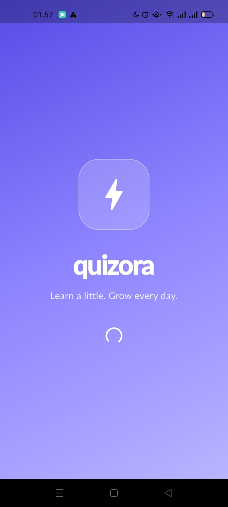
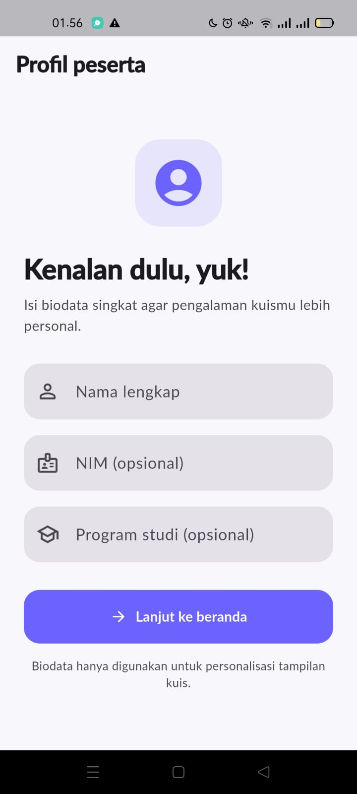
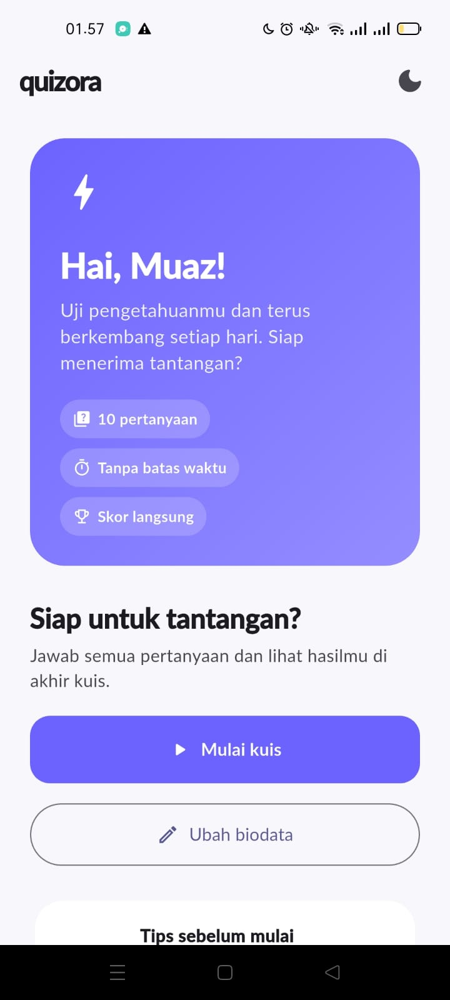
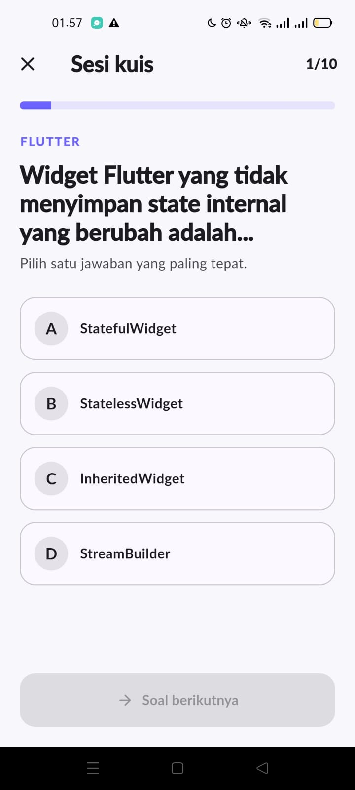
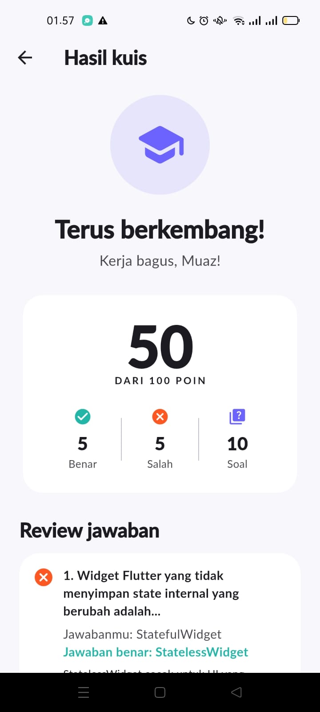

# Quizora — Aplikasi Kuis Pilihan Ganda

Quizora adalah aplikasi Flutter untuk UTS Pemrograman Mobile. Alur aplikasi meliputi Splash Screen → Biodata → Home → Quiz → Result. Pertanyaan disimpan secara lokal tanpa menggunakan database.

## 1. Identitas Mahasiswa

- **Nama:** Muaz Alfattah Fadhani
- **NIM:** 241401053
- **Lab:** PM 3

## 2. Informasi Aplikasi

- **Nama aplikasi:** Quizora
- **Deskripsi:** Aplikasi kuis pilihan ganda dengan profil peserta, progres pertanyaan, perhitungan skor, serta ulasan jawaban.
- **Fitur:**
  - Splash screen pembuka.
  - Form biodata dengan nama wajib diisi, sedangkan NIM dan program studi bersifat opsional.
  - Home dengan sapaan personal dan tombol mulai kuis.
  - 10 pertanyaan pilihan ganda tentang Flutter, Dart, dan Git.
  - Navigasi soal sebelumnya dan berikutnya serta indikator progres.
  - Validasi agar soal dijawab sebelum melanjutkan.
  - Hasil berupa skor, jumlah jawaban benar dan salah, serta review dan pembahasan.
  - State kuis dikelola dengan Provider selama sesi berlangsung.
  - Tema terang dan gelap.
  - Layout responsif dengan batas lebar konten untuk layar lebih lebar.

## 3. Teknologi

- Flutter dan Dart
- Provider (`ChangeNotifier`) untuk state management
- Material 3
- Custom font Lato

## 4. Cara Menjalankan

Buka folder proyek melalui terminal dan jalankan:

```powershell
flutter pub get
flutter devices
flutter run
```

Jika konfigurasi platform Android atau Web belum tersedia, jalankan `flutter create .` satu kali dari direktori proyek sebelum menjalankan aplikasi.

Untuk menjalankan aplikasi pada perangkat tertentu, gunakan `flutter run -d ID_PERANGKAT` sesuai ID yang ditampilkan oleh `flutter devices`.

## 5. Dokumentasi Screenshot

Screenshot antarmuka Quizora disimpan dalam folder `assets/images/screenshots/`.

### Splash Screen


### Biodata Screen


### Home Screen


### Quiz Screen


### Result Screen


## 6. UI/UX Mockup

Mockup antarmuka Quizora dibuat menggunakan Figma.

[View Quizora UI/UX Mockup on Figma](https://www.figma.com/design/pt18VggVMyRKxBqatzXrPp/Untitled?node-id=0-1&t=CK50vqOdQGYInnQI-1)

## 7. Video Presentasi

- **Link video Google Drive:** [TEMPELKAN LINK VIDEO]

Video presentasi berdurasi maksimal 10 menit. Pastikan izin akses Google Drive memungkinkan dosen dan asisten laboratorium membuka video.

## 8. Kredit Aset

- **Font:** Lato, disertakan dalam folder `assets/fonts/`. Sumber dan lisensi font perlu dicantumkan setelah diverifikasi.
- **Ikon:** Material Icons yang disediakan oleh Flutter SDK.
- **Gambar eksternal:** Tidak dicantumkan sebagai aset eksternal dalam dokumentasi ini.

## 9. State Management

Jawaban dan indeks soal dikelola melalui `QuizProvider` selama sesi aplikasi berlangsung. State digunakan untuk mempertahankan progres kuis ketika pengguna berpindah halaman. Perilaku saat rotasi perangkat perlu diuji untuk memastikan progres tetap terjaga pada perangkat target.

## 10. GitHub dan Pengumpulan

Repository GitHub digunakan untuk menyimpan kode sumber dan perkembangan pengerjaan melalui commit bertahap.

Sebelum pengumpulan, pastikan identitas mahasiswa sudah lengkap, seluruh fitur telah diuji, mockup dapat diakses, dan video presentasi sudah tersedia. Setelah semua persyaratan dipenuhi, push perubahan terakhir ke GitHub dan kumpulkan tautan repository melalui Google Classroom.
